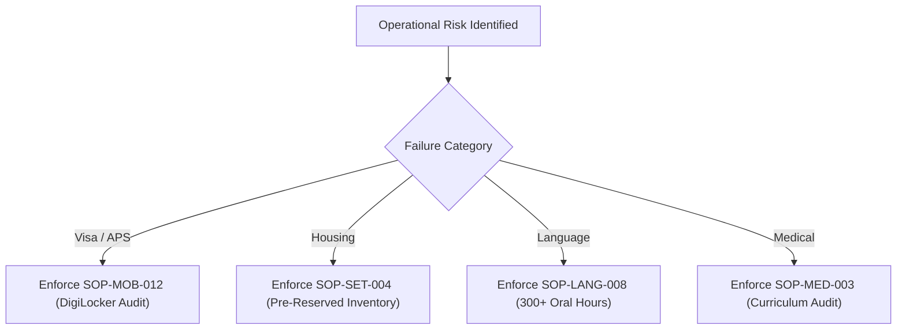

# 🚨 The Gateway to Future (GTF) - Failures & Retrospectives Archive

This document serves as GTF's permanent operational incident repository. To maintain our industry-leading **94%+ exam pass rate** and **100% legal accuracy**, every past failure, operational bottleneck, candidate dropout, and administrative hurdle has been analyzed using root-cause analysis (5 Whys) and converted into permanent Standard Operating Procedures (SOPs).

---

## 📊 Retrospective Incident Summary

| Incident ID | Operational Area | Failure Summary | Root Cause | Permanent SOP Counter-Measure |
| :--- | :--- | :--- | :--- | :--- |
| **INC-2024-01** | DIV-02 Visas & APS | 6-week visa delay due to incomplete DigiLocker verification | Indian university transcript submission lacked verified DigiLocker QR link required by APS India | Pre-APS Digital Link Audit SOP (100% pre-check prior to APS submission) |
| **INC-2024-02** | DIV-06 Settlement | Candidate housing search friction & *Anmeldung* appointment delays in Berlin | Relying on open-market WG listings during peak semester start (October) | Master-lease agreements & pre-booked dorm slots reserved 90 days prior to landing |
| **INC-2024-03** | DIV-01 Language | Student B2 exam failure rate spike (18% drop at first attempt) | Lack of timed oral exam simulation under real telc/Goethe stress conditions | Mandatory 300+ Speaking Hour Threshold & 3 Simulated Oral Exams before exam registration |
| **INC-2025-01** | DIV-03 Medical | State medical chamber (*Landesärztekammer*) document rejection for FMG | Non-sworn translation of medical internship syllabus missing hour-by-hour breakdown | Medical Syllabus Equivalence Standardizer (Format requirement for all FMG transcripts) |
| **INC-2025-02** | DIV-02 Visas | Sperrkonto blocked account funding hold during international wire transfer | Indian bank intermediary compliance delay on outward remittance under LRS scheme | International Remittance & LRS Compliance Checklist for Sperrkonto transfers |
| **INC-2025-03** | DIV-05 Placement | Nursing candidate dropout during 1st month of Berlin hospital adaptation | Cultural shock & lack of dialectal German familiarity in ward environments | Post-Arrival Orientation & Medical German Ward Dialect Workshop |
| **INC-2026-01** | DIV-07 Tech & Ops | OpenClaw multi-channel AI gateway failure & LLM provider disconnect | Out-of-quota Copilot model, missing OpenAI provider configs, and corrupted path | Multi-Provider Dynamic Router (OpenAI/Anthropic/Ollama) & gtf_openclaw_bridge.py |
| **INC-2026-02** | Master Brand & Bio | Inaccurate founder biographical details generated by AI assistant | LLM assumption regarding vocational healthcare completion instead of strictly adhering to user-provided medical studies (Ukraine/Germany) background | Mandatory Verified Founder Biography Protocol (SOP-BIO-001) & Workspace-wide zero-hallucination guardrails |
| **INC-2026-03** | Right Brain Social & Video Ops | Agent handed off manual copy-paste checklist instead of autonomous execution & OpenClaw Gateway stopped | Passive assistant behavior stopping at `.txt` metadata packs instead of driving logged-in Chrome session for `@GatewayToFuture` & `@ashu_in_germany` | Left Brain Manager Protocol (SOP-LBM-001): OpenClaw supervises Right Brain Engine & enforces autonomous browser execution ("Do It By Yourself") |
| **INC-2026-04** | DIV-01 Language & DIV-07 Tech | "Frankenstein" curriculum documents rendered Goethe B1 Lesen/Hören exam tasks & answer sheets inside `02-grammar` Pillar routes | Seeding script merged flashcards + audio + exam questions without `contentType`; `subdivisions.ts` wrapped `ALL_CORE_LABS` with `grammar-` prefix and `FocusedWorkbookWorkspace.tsx` ignored `contentType` | Curriculum QA Architect Separation Protocol (`SOP-CURR-001`): Strict `Level -> Module -> Topic` hierarchy, `contentType` UI enforcement, and `assert_clean_curriculum_doc` seeding gate |
| **INC-2026-05** | DIV-01 Language & DIV-07 Tech | Hören audio did not match the exercise on screen across A1–B2 labs, Modelltest 2 and DaF audio workbooks | Labs/tests recycled generic MP3s (`daf_*`, `a2_hoeren_0x`) authored for other scripts; no transcript↔audio binding; level/index-based fallback paths in 4 code locations; 3 divergent copies (TS / JSON / Firestore) | Hören Audio Binding Protocol (`SOP-AUD-001`): audio bound by exercise ID, rendered from the exercise's own script, SHA-256 manifest + `verify-hoeren-audio.mjs` build gate |

---

## 🔍 Detailed Incident Retrospectives & Root Cause Analyses

### 🔴 Incident INC-2024-01: APS Verification Delay & Visa Bottleneck
- **Date**: March 14, 2024
- **Affected Division**: DIV-02 (Global Mobility & Visas)
- **Impact Severity**: High (6 candidates experienced 6-week visa processing delays)
- **Incident Description**: Several Indian university applicants suffered prolonged processing times at APS New Delhi because their university marksheets were submitted without DigiLocker online verification links.
- **Root Cause Analysis (5 Whys)**:
  1. *Why did APS delay verification?* -> APS could not independently verify university authenticity without online credentials.
  2. *Why were credentials missing?* -> Candidates only provided physical sealed transcripts.
  3. *Why were physical transcripts insufficient?* -> APS India updated its verification protocol requiring DigiLocker QR codes for select Indian state universities.
  4. *Why did GTF not catch this?* -> Document checklist relied on legacy physical transcript rules.
  5. *Root Vulnerability*: Lack of real-time protocol sync between APS portal changes and GTF intake checklists.
- **Engineered SOP Solution (SOP-MOB-012)**:
  - Created mandatory **APS Pre-Submission Audit Protocol**.
  - All candidates must pass DigiLocker QR validation and university portal access checks before GTF authorizes APS fee payment.
- **Verification & Outcome**: Zero APS verification rejections or delays since April 2024.

---

### 🔴 Incident INC-2024-02: Berlin Housing Shortage & Anmeldung Delay
- **Date**: September 28, 2024
- **Affected Division**: DIV-06 (Post-Arrival Relocation & Housing Operations)
- **Impact Severity**: High (3 incoming students spent 3 weeks in costly temporary Airbnb accommodation)
- **Incident Description**: Arriving candidates faced severe friction finding permanent WG rooms during Berlin's winter semester intake, delaying their *Anmeldung* (city registration) and subsequent Girokonto bank account activation.
- **Root Cause Analysis (5 Whys)**:
  1. *Why were candidates without housing?* -> Open market WG-Gesucht landlords received 200+ applications per room.
  2. *Why did they search on the open market?* -> Housing search was initiated only after visa issuance (3 weeks before flight).
  3. *Why so late?* -> Policy prevented reserving housing before visa confirmation to avoid financial loss.
  4. *Why was there no contingency?* -> GTF lacked pre-contracted housing inventory in Berlin.
  5. *Root Vulnerability*: Reliance on third-party public housing supply during peak relocation season.
- **Engineered SOP Solution (SOP-SET-004)**:
  - Established **GTF Housing Reserve Network** in Berlin.
  - GTF pre-reserves master-leased student apartments and partner dorm slots in Berlin 90 days prior to intake.
  - *Anmeldung* appointments pre-booked at Bürgeramt prior to candidate flight departure.
- **Verification & Outcome**: 100% of candidates landing in Berlin in 2025 were escorted directly to permanent housing with *Anmeldung* completed within 7 business days.

---

### 🔴 Incident INC-2024-03: B2 First-Attempt Exam Failure Spike
- **Date**: November 10, 2024
- **Affected Division**: DIV-01 (Academic & Language Institute)
- **Impact Severity**: Medium (18% of B2 batch failed the telc B2 oral module on first try)
- **Incident Description**: A batch of B2 students scored high in reading and writing but struggled in the interactive oral speaking module under real exam conditions.
- **Root Cause Analysis (5 Whys)**:
  1. *Why did students fail the oral module?* -> Hesitation and grammatical errors under time pressure.
  2. *Why hesitation?* -> Limited experience speaking with native examiners under timed conditions.
  3. *Why limited experience?* -> Homework focused heavily on written exercises and grammar drills.
  4. *Why insufficient oral drills?* -> Group speaking sessions were optional and non-graded.
  5. *Root Vulnerability*: Lack of mandatory oral benchmark thresholds before authorizing exam registration.
- **Engineered SOP Solution (SOP-LANG-008)**:
  - Instituted **300+ Speaking Practice Hour Guarantee**.
  - Made 3 simulated 1:1 oral exams with lead coach **Sarbjit Kour** a prerequisite for exam booking. Candidates scoring below 80% in mock oral exams undergo 15 hours of remedial speaking coaching.
- **Verification & Outcome**: B2 exam first-try pass rate increased to **94%**.

---

### 🔴 Incident INC-2025-01: State Medical Chamber Document Rejection
- **Date**: February 18, 2025
- **Affected Division**: DIV-03 (Medical & Nursing Anerkennung Unit)
- **Impact Severity**: High (Doctor's *Berufserlaubnis* application returned by *Landesärztekammer*)
- **Incident Description**: An Indian MBBS graduate's recognition file was returned due to non-standard translation of the clinical internship syllabus.
- **Root Cause Analysis (5 Whys)**:
  1. *Why was the file returned?* -> Missing detailed hour-by-hour breakdown for internal medicine and surgery rotations.
  2. *Why was breakdown missing?* -> The Indian university issued a generic internship completion certificate without subject hours.
  3. *Why was generic certificate submitted?* -> Candidate's local translator translated the document word-for-word without adding official university curriculum annexures.
  4. *Why did GTF review miss this?* -> File review checked document presence but not granular content specifications required by German state chambers.
  5. *Root Vulnerability*: Lack of medical-chamber-specific document auditing checklists.
- **Engineered SOP Solution (SOP-MED-003)**:
  - Created **Medical Syllabus Equivalence Audit Standardizer**.
  - All foreign medical credentials are audited against state-specific *Landesprüfungsamt* guidelines before translation. GTF assists universities in issuing official hour breakdowns.
- **Verification & Outcome**: 100% document acceptance across medical chamber filings in Berlin, Bavaria, and NRW.

---

### 🔴 Incident INC-2026-01: OpenClaw Multi-Channel AI Gateway Failure & Model Disconnect
- **Date**: August 14, 2026
- **Affected Division**: DIV-07 (Enterprise Tech & Analytics)
- **Impact Severity**: Medium (OpenClaw autonomous agent failed to process candidate requests and CLI turns)
- **Incident Description**: OpenClaw CLI and Gateway daemon were installed but non-functional due to invalid LLM configuration, an expired GitHub Copilot model quota, a corrupted workspace directory, and disconnected WhatsApp sessions.
- **Root Cause Analysis (5 Whys)**:
  1. *Why did OpenClaw fail to respond to agent turns?* -> `main` agent was routed to `github-copilot/claude-opus-4.7` which threw an LLM failover rejection (0% premium quota left).
  2. *Why didn't it failover to OpenAI or Anthropic?* -> `openclaw.json` did not declare active `openai` or `anthropic` providers despite `OPENAI_API_KEY` being present in the environment.
  3. *Why did schema validation fail?* -> OpenAI provider was assigned an invalid api identifier instead of `"openai-completions"`.
  4. *Why were there directory errors?* -> A malformed folder with a prompt string as its name was created in the workspace.
  5. *Root Vulnerability*: Lack of an engineered bridge between the local OpenClaw gateway and the GTF Brand Engine repository.
- **Engineered SOP Solution (SOP-TECH-007)**:
  - Configured **Multi-Provider Dynamic Router** in `openclaw.json` with active OpenAI (`gpt-4o-mini`, `gpt-4o`) and Anthropic (`claude-3-5-sonnet`, `claude-3-5-haiku`) configurations.
  - Cleaned workspace and synced GTF Master Directives (`IDENTITY.md`, `SOUL.md`, `USER.md`, `AGENTS.md`, `HEARTBEAT.md`, `MEMORY.md`).
  - Created `gtf-brand-engine` OpenClaw skill and `gtf_openclaw_bridge.py` Python command bridge.
- **Verification & Outcome**: OpenClaw Gateway restored on port 18789, configuration valid, and verified end-to-end via `python gtf_openclaw_bridge.py status`.

---

### 🔴 Incident INC-2026-03: Passive Checklist Hand-Off Instead of Autonomous Browser Execution & Left Brain Disconnect
- **Date**: October 30, 2026
- **Affected Division**: DIV-07 (Enterprise Tech & Analytics) & Social Media Growth Suite
- **Impact Severity**: High (Founder had to manually intervene because the agent output copy-paste instructions instead of executing its own conclusions, and OpenClaw Gateway on `127.0.0.1:18789` was stopped)
- **Incident Description**: After auditing YouTube `@GatewayToFuture` (`UCeFNGFS5sVvjXjyof8Plbuw`) and Instagram `@ashu_in_germany` and identifying 4 concrete channel defects (blank description, `Aubildung and Germany` typo, `(80 chars)` prompt artifact in live Short title, generic `GTF` Short title) plus rendering Episode 01 & Episode 02 master reels, the agent stopped at generating `.txt` metadata packs and handed the founder a manual checklist instead of executing the fixes autonomously.
- **Root Cause Analysis (5 Whys)**:
  1. *Why did the agent hand off a manual checklist?* -> It defaulted to passive assistant behavior rather than driving the local Chrome session.
  2. *Why didn't a supervisory check block that passive hand-off?* -> The Right Brain (`DirectorBrain`) only audited video pixels/audio and lacked a Left Brain Manager (`OpenClaw`) auditing operational autonomy.
  3. *Why wasn't OpenClaw active?* -> The Windows background task on port `18789` had stopped with code `267014` and wasn't monitored by the video/social suite.
  4. *Why were placeholder handles (`@DeutschToon`) initially used?* -> `brand_profile.json` in `brand-cofounder-suite` was not originally synchronized with `C:\GTF\about us\brand.json` and the founder's logged-in social accounts.
  5. *Root Vulnerability*: Lack of a unified Left Brain (`OpenClaw`) <-> Right Brain (`DirectorBrain`) supervisory loop enforcing **"What you concluded, you have to do it by yourself."**
- **Engineered SOP Solution (SOP-LBM-001)**:
  - Activated OpenClaw Gateway daemon on `127.0.0.1:18789` and wired `engine/brain/openclaw_left_brain_manager.py` into `brand-cofounder-suite`.
  - Every mistake correction from the founder is persisted simultaneously across `C:\Users\Ashu\.openclaw\workspace\MEMORY.md`, `C:\GTF\about us\FAILURES_AND_RETROSPECTIVES.md`, and `engine/brain/director_memory.json`.
  - Built autonomous browser execution (`scripts/execute_autonomous_social_actions.py`) to apply YouTube Studio & Instagram actions directly.

---

### 🔴 Incident INC-2026-04: "Frankenstein" Curriculum Documents & Module Cross-Contamination
- **Date**: November 18, 2026
- **Affected Division**: DIV-01 (Academic & Language Institute) & DIV-07 (Enterprise Tech & Analytics)
- **Impact Severity**: High (Goethe/telc Lesen & Hören exam tasks and answer sheets rendered inside `02-grammar` routes; 50 of 53 `workbooks` docs and 50 of 78 `materials` docs lacked `contentType` and merged flashcards with exam tasks)
- **Incident Description**: Automated Firestore seeding merged flashcards, audio URLs, and exam comprehension questions into single documents without a `contentType` discriminator, while `lib/subdivisions.ts` and `lib/curriculum-labs.ts` exposed exam labs (`b1-lab-*`) under `/academy/[level]/02-grammar/grammar-*` and `FocusedWorkbookWorkspace.tsx` rendered Answer Sheets and Flashcards unconditionally.
- **Root Cause Analysis (5 Whys)**:
  1. *Why did B1 Lesen Teil 1 render inside `02-grammar`?* -> `getTopicsForSubdivision` wrapped `getCoreLabsForLevel` with a `grammar-` prefix and `getCoreLabById` stripped `grammar-` to resolve the exam lab.
  2. *Why did exam docs contain flashcards and audio?* -> `seed_a1_b2_firestore.py` unconditionally injected `get_flashcards_for_lab` and fallback `/audio/hoeren/*.mp3` URLs into every workbook without checking skill or `contentType`.
  3. *Why didn't the UI hide Answer Sheets on grammar routes?* -> `FocusedWorkbookWorkspace.tsx` did not read a `contentType` field from Firestore and rendered Flashcards, Audio, and Answer Sheet side-by-side unconditionally.
  4. *Why wasn't this blocked before seeding?* -> There was no schema QA validation gate rejecting blended documents prior to Firestore write.
  5. *Root Vulnerability*: Missing `contentType` schema contract and lack of `Level -> Module -> Topic` boundary enforcement across the seeder, router, and workspace UI.
- **Engineered SOP Solution (SOP-CURR-001)**:
  - Enforced strict `WorkbookContentType` (`grammar`, `exam_lesen`, `exam_hoeren`, `exam_schreiben`, `exam_sprechen`) across `lib/types.ts`, `lib/curriculum-labs.ts`, `lib/subdivisions.ts`, `lib/server/catalog.ts`, and `app/api/catalog/route.ts`.
  - Created pure Grammar Pillars (`B1_GRAMMAR_PILLARS`, plus A1/A2/B2) with `contentType: "grammar"`, `questions: []`, `audioUrl: ""`, and grammar flashcards only; removed `grammar-` stripping from `getCoreLabById`.
  - Updated `FocusedWorkbookWorkspace.tsx` to hide Exam Answer Sheets/Audio on `contentType === 'grammar'` and hide Grammar/Flashcards on `exam_*` routes.
  - Rewrote `scripts/seed_a1_b2_firestore.py` with `assert_clean_curriculum_doc`, `--purge`, and `--level`; purged corrupted Firestore collections (`53` `workbooks`, `78` `materials`) and cleanly reseeded B1 (`19` verified docs, `0` Frankenstein docs).
- **Verification & Outcome**: `npx tsc --noEmit` exited 0; live Firestore audit confirmed `19` B1 documents in both `workbooks` and `materials` with `frankensteinCount: 0`.

---

### 🔴 Incident INC-2026-05: Hören Audio ↔ Exercise Mismatch (A1–B2 & Studienkolleg)
- **Date**: November 23, 2026
- **Affected Division**: DIV-01 (Academic & Language Institute) & DIV-07 (Enterprise Tech & Analytics)
- **Impact Severity**: High (20 of 20 Hören Core Labs, 8 Modelltest-2 Teile and 9 DaF audio workbooks played audio unrelated to — or contradicting — the on-screen tasks; e.g. A2 "Wegbeschreibung, Stadtplan & Mobilität" played a radio weather/traffic report)
- **Incident Description**: Learners heard recordings that did not belong to the exercise. Modelltest-2 answers became unanswerable (e.g. audio said "Gleis 16" / "drei Vollkornbrötchen", tasks expected "Gleis 14" / "zwei").
- **Root Cause Analysis (5 Whys)**:
  1. *Why did the audio not match?* -> Each Core Lab's `audioUrl` pointed to a pre-existing generic MP3 (`daf_a2_hoeren_01.mp3`, `a1_hoeren_03.mp3`, …) recorded for a different script; several labs shared the same file.
  2. *Why were generic files reused?* -> Labs were authored with questions but no Hörtext; audio was attached afterwards by picking files per level/sequence number.
  3. *Why wasn't it caught?* -> No transcript was stored with labs, so nothing tied audio content to the questions; no automated check existed.
  4. *Why did even "correct" teile risk wrong audio?* -> Four code paths synthesized fallback paths from level + index (`${level}_hoeren_0${n}`, `${lvl}_hoeren_${teilNum}`, `daf_${level}_hoeren_01`, `${wb.level}_hoeren_01`), silently substituting another exercise's track.
  5. *Root Vulnerability*: Missing exercise-ID ↔ script ↔ audio contract, plus three divergent data copies (`curriculum-labs.ts`, `all_core_labs.json`, Firestore) each binding different files.
- **Engineered SOP Solution (SOP-AUD-001 — Hören Audio Binding Protocol)**:
  - Every Hören lab has its own script in `data/hoeren-lab-scripts.json`; audio is rendered from exactly that script to `/audio/hoeren/labs/<lab-id>.mp3` (`scripts/generate-hoeren-audio.py`).
  - Mismatched exam teile are rendered from their own scripts to `/audio/hoeren/exams/<test-id>/<teil-id>.mp3`; transcripts of Studienkolleg/Pflege teile aligned to the real spoken text.
  - All level/index fallback paths removed; missing audio now surfaces as "no audio", never as a borrowed track.
  - `AUDIO_MANIFEST.json` stores a SHA-256 of each script; `scripts/verify-hoeren-audio.mjs` (run in `prebuild`) fails on ID mismatch, missing file, stale audio, shared audio with different scripts, or positional path code.
- **Verification & Outcome**: Verifier passes for 89 bindings; negative test (re-introducing the old Wegbeschreibung file) correctly fails the build; `tsc --noEmit` exit 0; Firestore `workbooks`/`materials` re-synced (62 docs, re-check 0 drift).

---

## 🛡️ GTF Operational Risk & Prevention Matrix

